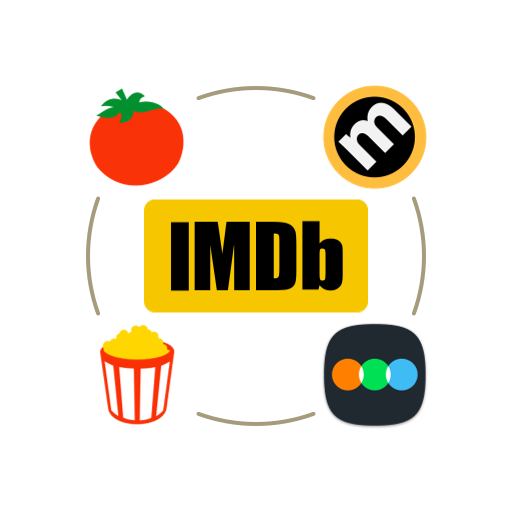
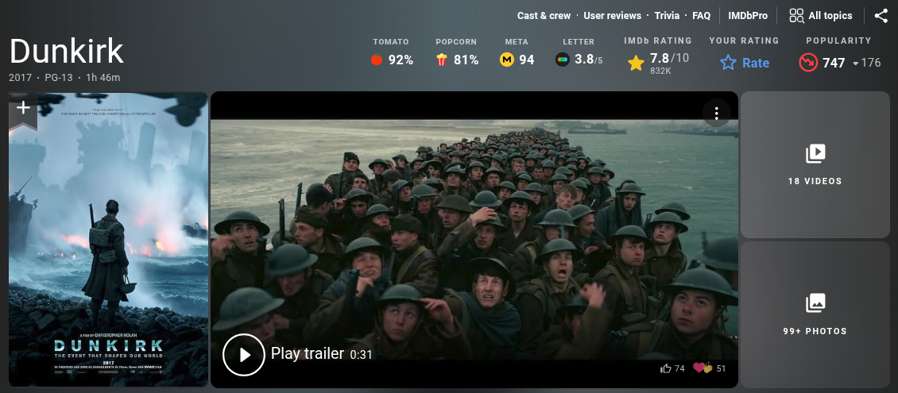

  

<h1 align="center">RatingHub</h1>

  All your movie ratings. One place.

RatingHub brings ratings from multiple trusted platforms directly to IMDb title pages, making it easier to compare ratings without leaving IMDb.

    
    
    

## Preview

    

## Features

- **Unified Ratings**: View external ratings alongside IMDb's native rating
- **Smart Caching**: Cache rating data and resolved external links to reduce unnecessary requests
- **Verified Links**: Validate external rating pages before displaying direct links
- **Lightweight**: Integrates directly into IMDb title pages

## Rating Sources

- **Rotten Tomatoes**: Tomatometer & Audience Score
- **Metacritic**: Metascore
- **Letterboxd**: Community Rating

## Requirements

- [Tampermonkey](https://www.tampermonkey.net/) or a compatible userscript manager
- An [MDBList API key](https://mdblist.com/)

## Installation

1. Install [RatingHub from Greasy Fork](https://greasyfork.org/en/scripts/604262-ratinghub).
2. Open an IMDb movie or TV show page
3. Open the Tampermonkey menu
4. Select **Set MDBList API Key**
5. Enter your MDBList API key

## License

This project is license under the [MIT License](LICENSE).
